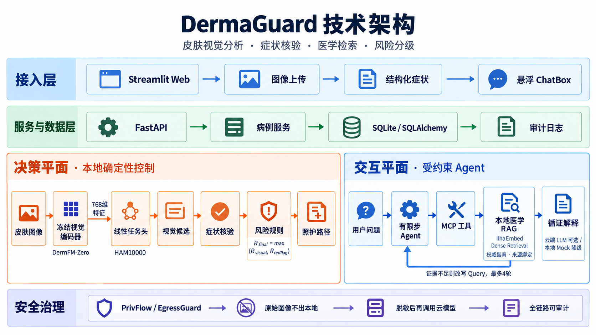
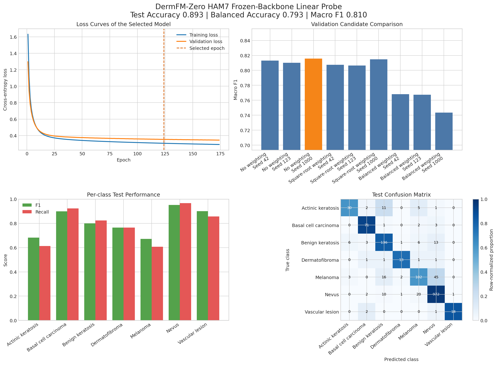

# DermaGuard 项目介绍与技术汇报

> 更新日期：2026 年 10 月 12 日  
> 定位：面向基层医疗的皮肤疾病辅助决策 Agent。系统用于辅助筛查、风险分级和转诊建议，不替代医生诊断。

## 1. 项目背景

基层医疗机构的皮肤专科资源有限，而现实中的皮肤病灶评估不能只依赖一张图片。除了外观，还需要考虑病程、变化速度、出血或破溃、全身症状以及不同证据之间的冲突。

单纯图像分类只能输出候选类别，无法完成症状核验、风险升级和后续就医导航。通用大模型虽然擅长文本生成，但医学依据可能不可追溯，也存在幻觉和隐私数据外发风险。

因此，项目采用“**专业皮肤视觉模型 + 结构化症状 + 本地医学 RAG + 确定性风险规则 + 受约束 Agent**”的方案，形成“识别—核验—检索—风险判断—建议”的完整辅助决策流程。

## 2. 整体架构



> 如果当前 Markdown 预览器不支持嵌入图片，可[单独打开架构图](./artifacts/figures/dermaguard_system_architecture.png)。

架构分为两个平面：

- **决策平面**：视觉证据、红旗症状、风险分级和照护路径由本地服务与固定规则控制，LLM 无权修改。
- **交互平面**：Agent 负责检索规划、证据整合和自然语言解释，通过 MCP 访问受控本地能力。

## 3. 开发框架与技术范式

| 层级 | 主要技术 | 作用 |
|---|---|---|
| Web 交互 | Streamlit、HTML/CSS/JavaScript | 图片上传、症状表单、结果展示和悬浮 ChatBox |
| 后端服务 | FastAPI、Uvicorn、Pydantic | REST 接口、数据校验与服务编排 |
| 视觉推理 | PyTorch、作者 OpenCLIP 分支 | 冻结特征提取与轻量线性分类 |
| 医学检索 | Transformers、IlhaEmbed | 本地 Dense Retrieval 与指南来源绑定 |
| Agent | 有限步 ReAct 风格循环、结构化 Schema | 证据缺口判断、Query 改写、终止与追问 |
| 工具协议 | 官方 Python MCP SDK | 6 个只读工具，与 REST 共用 Service Layer |
| 存储审计 | SQLite、SQLAlchemy | 病例结果、对话、工具调用与出境审计 |
| 语言生成 | 本地 Mock、智谱 GLM、Groq 兼容接口 | 受控检索规划与解释，失败时自动降级 |

项目使用了基础模型迁移学习、冻结 Backbone + Linear Probe、RAG、ReAct 风格工具调用、MCP、确定性安全策略和可降级服务等主流技术范式。

## 4. 视觉模型与实验结果

项目使用 [DermFM-Zero 官方代码](https://github.com/SiyuanYan1/DermFM-Zero) 与 Hugging Face 的 [DermFM-Zero-Open checkpoint](https://huggingface.co/redlessone/DermFM-Zero)。该模型是面向皮肤科的视觉—语言基础模型，可用于零样本分类、图文检索和低标注下游任务。

官方对完整训练路线的描述是：先通过 masked latent modelling 学习超过 **300 万张皮肤图像**，再在约 **100 万个图文对**上完成对比对齐。当前下载的 Open 版模型卡另外列明：其公开版对齐数据包含 **517,455 个图文对**，其中临床照片 406,831 张、皮肤镜图像 110,624 张，视觉编码器由 PanDerm-Large 初始化。

本项目不重新训练大型 Backbone，而是将其冻结，在 HAM10000 官方七类划分上训练 `Linear(768, 7)` 任务头，可训练参数仅 **5,383** 个。

| 数据集 | 数量 | 用途 |
|---|---:|---|
| 训练集 | 8,012 | 训练线性头 |
| 验证集 | 500 | 选模、早停和温度校准 |
| 测试集 | 1,503 | 最终独立评估 |

最终选中随机种子 1000、无类别加权、第 124 轮的模型：

| 测试指标 | 结果 |
|---|---:|
| Accuracy | **89.29%** |
| Balanced Accuracy | **79.34%** |
| Macro-F1 | **80.98%** |



该实验说明冻结视觉特征在固定皮肤镜任务上具有较好迁移能力，但不等同于真实临床准确率。测试集中黑色素瘤召回率为 60.71%，因此系统仍保留低置信度拒识、症状核验和人工复核。

## 5. 症状与视觉结果冲突处理

系统不会盲目使用视觉 Top-1。图像分析后会核验病程、快速变化、边界或颜色变化、自发出血或破溃、感染进展和系统性危险信号。最终风险使用本地规则：

```text
R_final = max(R_visual, R_redflag)
```

症状核验只能维持或上调风险，LLM 不能自行下调。例如，视觉候选中色素痣排名最高，但患者补充“近期快速增大、无诱因出血”时，系统会识别多个红旗特征，提高风险等级，并检索黑色素瘤警示征象、检查与转诊依据。

## 6. 本地医学 RAG

当前知识库包含 **17 篇**结构化 Markdown 文档，来源包括 AAD、NICE、CDC 和 DermNet 等医学机构与专业资料。文档按章节和语义段落切分，每个 chunk 保留文档名、机构、年份、章节、页码或网页位置、版本和来源链接。

检索 Query 动态组合用户问题、视觉候选、阳性症状、风险原因、病程和当前主题。返回的证据按风险、鉴别、检查、转诊、冲突和信息缺口组织；低于阈值时明确提示“当前知识库证据不足”。

Dense Retrieval 使用 Hugging Face 的 [weemed/IlhaEmbed](https://huggingface.co/weemed/IlhaEmbed) 本地实体权重：

- 当前项目使用的 checkpoint 约 **3,812 万参数**、输出 **384 维**向量，权重约 146 MB；
- 基于 Granite ModernBERT 架构，面向台湾繁体中文临床术语、缩写和就医分流进行领域适配；
- 官方说明中的医学适配主要来自对比学习和关系知识蒸馏，包含公开医学术语资源；
- 它是小型医学领域嵌入模型，**不是皮肤科专用模型**。

Dense 模型无法加载或超时时，系统自动使用确定性词项重叠检索作为 fallback。

## 7. Agent 设计

DermaGuard 使用单一、收敛型的对话 Agent，不堆叠多 Agent。它具有 ReAct 风格的“判断—行动—观察”循环，但通过结构化 Schema、工具白名单和最多 4 轮检索保证可终止。

```text
LLM 判断当前缺少哪类证据
  → 生成或改写 Query
  → 通过 MCP 调用本地 search_guideline
  → RAG 返回带来源的指南证据
  → LLM 判断证据是否充分
  → 不足则改写 Query，充分则组织回答
```

Agent 可通过 MCP 访问视觉证据、分诊结果、医学指南、照护路径、隐私报告和症状校准结果六个只读工具。LLM 不直接充当医学知识库，主要负责检索规划、信息整合和交互表达。

## 8. 隐私与安全

- 原始图像、图像字节、Base64、EXIF 和本地路径不发送给云端 LLM。
- 病例上下文和检索 Query 在外发前经过 PrivFlow/EgressGuard 脱敏与出境检查。
- 医疗高风险内容由结构化红旗规则和四级照护路径约束。
- LLM 不能修改视觉分数、风险等级或转诊路径。
- 医学结论尽量绑定知识库来源，证据不足时明确说明。
- Dense Retriever 失败时降级为本地词法检索；云端 LLM 失败时降级为本地 Mock 解释。
- 工具调用、出境检查和模型回退均可记录到 SQLite 中供审计。

## 9. 完整案例

**场景：视觉结果偏向色素痣，但患者反馈近期增大并出血。**

1. 用户上传皮肤镜图像，视觉编码器提取 768 维特征，线性头给出候选排序，色素痣排名最高。
2. 系统不将该结果当作确诊，继续询问病程、增大速度、边界颜色变化、出血和破溃。
3. 用户确认“近期明显增大”与“无诱因出血”，系统识别到多个红旗特征与视觉候选存在冲突。
4. 本地规则上调风险为优先转诊，但不将其表述为黑色素瘤确诊。
5. Agent 生成首轮 Query：“色素痣 快速增大 无诱因出血 黑色素瘤警示征象 检查指征 转诊指南”。
6. RAG 返回 AAD 色素痣/黑色素瘤警示资料和 NICE 可疑皮肤癌转诊依据，并保留机构、年份、章节和来源。
7. 如果首轮证据尚未覆盖检查与转诊，Agent 第二轮改写 Query，补充检索皮肤镜复核、活检指征与优先转诊依据。
8. 最终回答说明“视觉候选偏向色素痣，但快速增大和自发出血需要优先排除高风险病变”，建议尽快由皮肤科医生结合皮肤镜及必要时的病理检查进一步判断，同时绑定指南来源。

## 10. 工程与落地优势

- 视觉 Backbone 冻结，可通过轻量任务头低成本扩展固定下游任务。
- RAG 、规则和结构化存储本地运行，知识库可持续更新，无需重新训练视觉模型。
- 单 Agent、六个 MCP 工具与共用 Service Layer，结构清晰，便于审计和替换 Provider。
- 云模型或 Dense Retriever 不可用时，关键风险分级和基本解释仍可运行。
- 适合基层初筛、社区筛查、健康咨询、转诊辅助和教学演示。

## 11. 项目亮点

1. **专业皮肤视觉基础模型**：利用大规模皮肤图像和图文数据学到的视觉表征。
2. **多源证据融合**：同时结合图像候选、结构化症状、风险规则和医学指南。
3. **动态可追溯 RAG**：根据证据缺口改写查询，并保留来源与章节信息。
4. **受约束 Agent**：LLM 负责规划和解释，不掌握医疗风险决策权。
5. **轻量、低成本、可落地**：本地优先、支持拒识与降级，适合资源受限的基层场景。


## 12. 当前完成状态

| 能力 | 状态 |
|---|---|
| 单图视觉推理与 HAM 线性头 | 已接入 Web/API 实际链路 |
| 图像质量、拒识与四级照护路径 | 已完成 |
| 结构化症状核验与风险上调 | 已完成 |
| 本地指南知识库与 Dense Retrieval | 已完成，文档覆盖可继续扩充 |
| 有限步 Agent 与 6 个 MCP 工具 | 已完成 |
| PrivFlow 出境检查与 SQLite 审计 | 已完成 |
| Streamlit 页面与悬浮 ChatBox | 已完成 |
| LLM 和检索失败降级 | 已完成 |

当前项目已形成从图像上传、症状核验、风险冲突处理、动态医学检索到可解释建议的端到端演示系统。后续重点应是扩充权威知识、增加真实场景验证，并持续评估检索命中率、拒识与高风险召回。
