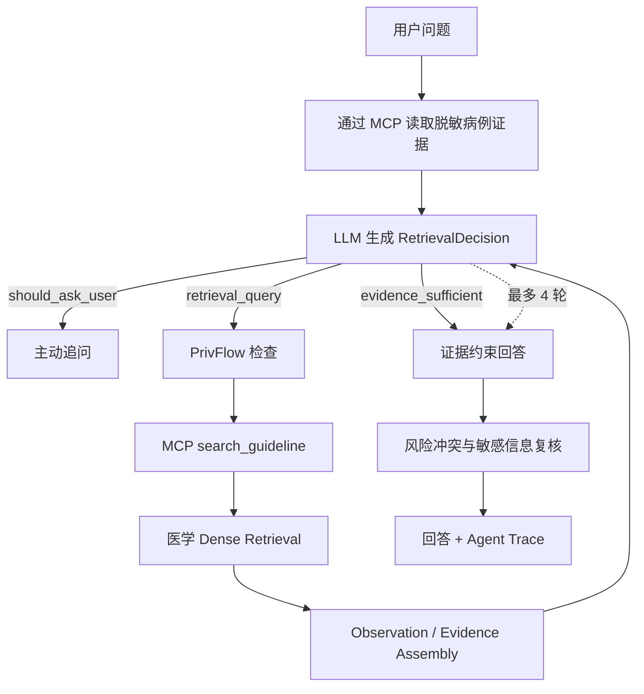

# DermaGuard 有限步检索 Agent

## 定位

Agent 只负责理解问题、构造检索语句、判断证据是否充分、必要时追问，以及根据证据组织回答。视觉结果、医疗风险等级和照护路径仍由本地服务与确定性规则产生，LLM 无权修改。

## 数据流



## RetrievalDecision

LLM 每轮只返回受约束的检索决策：

- `intent`：当前问题意图；
- `retrieval_query`：下一轮医学检索语句；
- `missing_information`：当前证据缺口；
- `should_ask_user` 和 `clarification_question`：是否需要追问；
- `evidence_sufficient`：是否可以终止检索并回答；
- `reasoning_summary`：一句可审计理由，不保存详细思维过程。

Schema 中没有风险分数、分级修改或任意工具调度字段。

## MCP 工具边界

Agent 通过同一 `ToolRegistry` 调用已注册的只读 MCP 工具，不绕过 MCP 直连业务实现。基础病例证据按问题类型读取，指南证据由 `search_guideline` 取得。每次调用都经过 JSON Schema 参数校验、EgressGuard 和 SQLite 审计。

## RAG 流程

```text
用户问题 + 脱敏病例证据
  -> 动态检索 query
  -> 轻量医学 Dense Retrieval
  -> 必要 Top-K
  -> Evidence Assembly
  -> 充分性判断
```

当 Dense 模型无法加载时，系统才使用确定性词项重叠作为本地降级。当前不默认叠加 BM25、RRF、手工融合权重或多重精排。

## 终止与降级

- 证据充分时立即停止检索。
- 证据不足时改写 query，最多检索 4 轮。
- 重复 query 不会反复调用检索工具。
- LLM 无法返回有效决策时，执行一次确定性本地检索降级。
- 云端回答失败、出现风险冲突或敏感信息泄露时，改用本地受控回答。

## 风险不变式

```text
R_final = max(R_visual, R_redflag)
```

结构化症状只能通过明确红旗规则维持或上调风险。LLM 的检索判断和文本回答都不会写入风险决策。

## 审计

SQLite `agent_traces` 保存步骤号、意图、query、证据充分性、信息缺口、Observation 摘要、Provider 和 fallback 状态；不保存详细思维过程。
